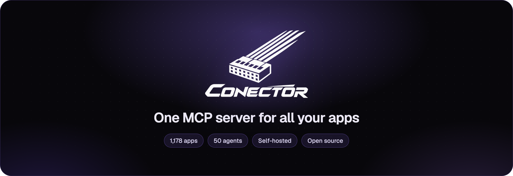
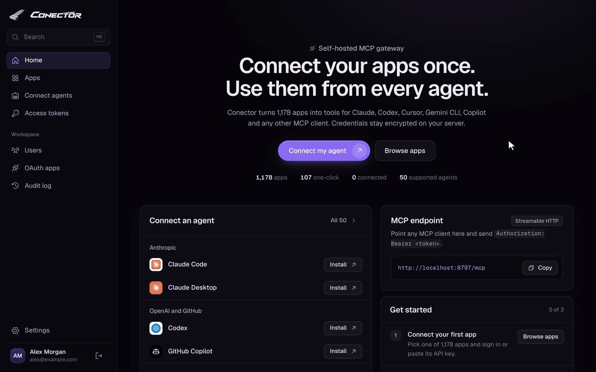
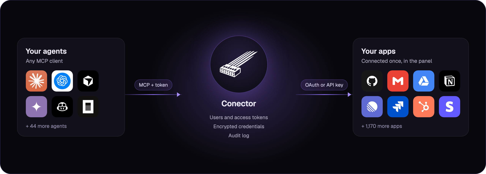
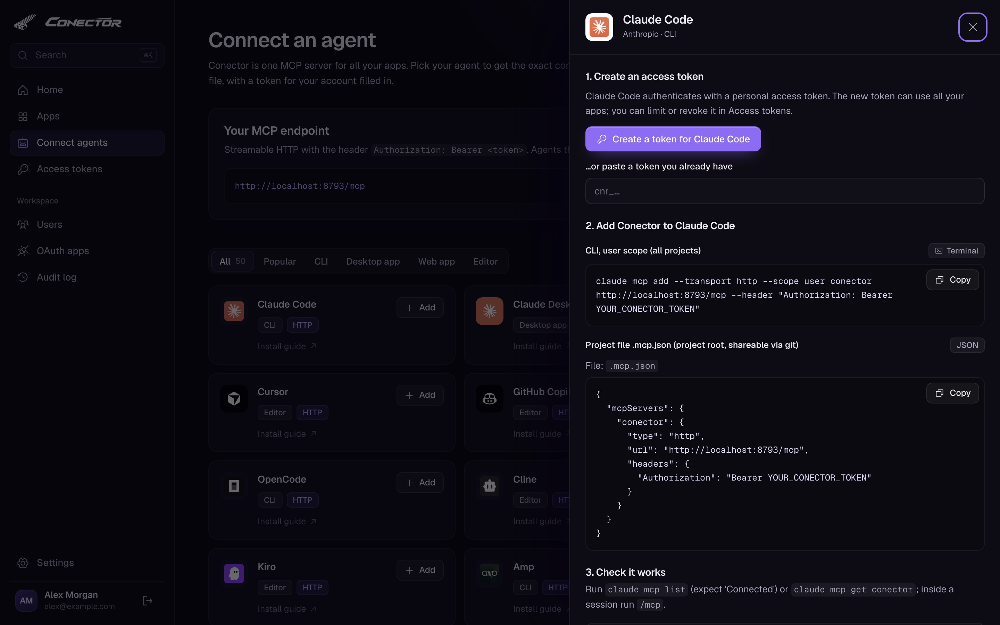
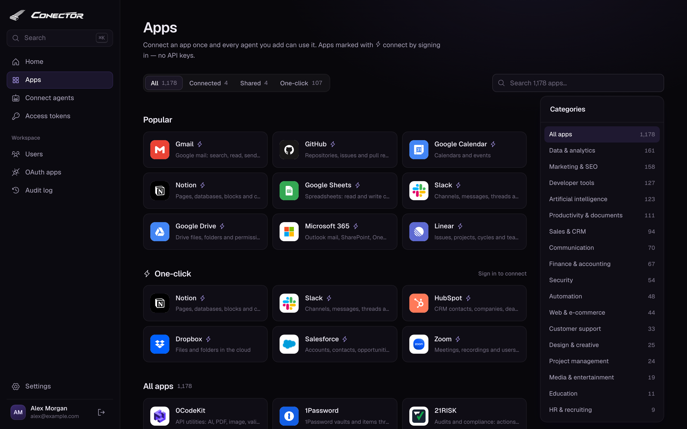

<p align="center">
  
</p>

<p align="center">
  <b>Connect 1,178 apps once and use them from Claude, Codex, Cursor, Gemini CLI, GitHub Copilot and 42 more AI agents.</b><br>
  Self-hosted and open source. Your credentials stay encrypted on your own server.
</p>

<p align="center">
  <a href="https://github.com/Secra-Solutions/Conector/releases/latest"></a>
  <a href="https://www.npmjs.com/package/conector"></a>
  <a href="https://github.com/Secra-Solutions/Conector/actions/workflows/ci.yml"></a>
  <a href="LICENSE"></a>
  
  
  
  
  <a href="https://secra.es/en"></a>
</p>

<p align="center">
  <a href="#quick-start">Quick start</a> ·
  <a href="#connect-an-agent">Agents</a> ·
  <a href="#apps">Apps</a> ·
  <a href="#users-and-security">Security</a> ·
  <a href="docs/ADDING_APPS.md">Add an app</a> ·
  <a href="#powered-by-secra-solutions">About</a>
</p>

<p align="center">
  
</p>

## Why Conector

AI agents can only use the tools they can reach. Wiring every agent to every app means juggling API keys, OAuth apps and
config files on each machine, for each agent. Conector puts all of it in one place:

1. **Connect an app once** in the web panel, by signing in or pasting an API key.
2. **Add Conector to your agents** with one command or config snippet.
3. **Every agent gets tools for every app you connected**, over the [Model Context Protocol](https://modelcontextprotocol.io).

<p align="center">
  
</p>

## Features

<table>
  <tr>
    <td width="33%" valign="top">
      <b>1,178 apps</b><br>
      GitHub, Gmail, Google Drive, Notion, Slack, Linear, HubSpot, Salesforce, Stripe, Microsoft 365, Jira and more.
      107 connect with one click. The rest take an API key, a username and password, or nothing at all.
    </td>
    <td width="33%" valign="top">
      <b>1,416 tools</b><br>
      Every app gets an authenticated <code>&lt;app&gt;_request</code> tool for its whole API. Many add specific tools such
      as <code>outlook_search_mail</code>, <code>jira_search</code> or <code>slack_send_message</code>.
    </td>
    <td width="33%" valign="top">
      <b>47 agents</b><br>
      The panel shows the exact command or config file for each agent, with a token already filled in.
      <code>conector install &lt;agent&gt;</code> writes it for you.
    </td>
  </tr>
  <tr>
    <td valign="top">
      <b>Built for teams</b><br>
      Admins and members, invitation links, personal and shared connections, and per-agent tokens limited to the apps
      you choose.
    </td>
    <td valign="top">
      <b>Private by design</b><br>
      Credentials are encrypted with AES-256-GCM and only sent to the app they belong to. The panel loads no external
      scripts, fonts or images.
    </td>
    <td valign="top">
      <b>Easy to run</b><br>
      Node.js and three dependencies, or one <code>docker compose up</code>. Every tool call is recorded in an audit log.
    </td>
  </tr>
</table>

## Quick start

With [Node.js](https://nodejs.org) 22 or later, in one command:

```bash
npx conector start
```

Installed from npm, Conector keeps its data in `~/.conector`. For a permanent install, run `npm install -g conector` and
then `conector start`.

With Docker:

```bash
docker run -d --name conector -p 127.0.0.1:8790:8790 -v conector-data:/data ghcr.io/secra-solutions/conector
docker logs conector    # shows the setup link
```

Or from source:

```bash
git clone https://github.com/Secra-Solutions/Conector.git
cd Conector
npm install
npm start
```

The first start prints a one-time setup link:

```
Conector 0.1.0 listening on http://127.0.0.1:8790 — public URL http://localhost:8790
No users yet. Create the admin account at:
  http://localhost:8790/setup?code=…
```

Open it, create the admin account, and then:

1. **Apps:** pick an app and connect it.
2. **Connect agents:** pick your agent, click **Create a token**, and copy the command or snippet.
3. Ask your agent to use the app, for example: "list my open GitHub pull requests".

### With Docker Compose

From a clone of the repository:

```bash
docker compose up -d
docker compose logs conector    # shows the setup link
```

The data (users, tokens, encrypted credentials and the master key) lives in the `conector-data` volume. The compose
file only exposes the panel on `127.0.0.1:8790`. Images for amd64 and arm64 are published at
`ghcr.io/secra-solutions/conector`: `latest` and `X.Y.Z` for releases, `edge` for the main branch.

## Connect an agent

<p align="center">
  
</p>

Each agent authenticates with its own access token (`cnr_…`) and talks to `http://<server>/mcp` over Streamable HTTP,
with an `Authorization: Bearer` header. Agents that can only start local (stdio) servers use the bundled bridge,
`bin/stdio-bridge.js` (or `conector stdio`), configured with `CONECTOR_URL` and `CONECTOR_TOKEN`. It has no
dependencies, so you can copy it to any machine with Node.js. On the machine where Conector stores its data, an agent
can also start `conector mcp`, which serves the same tools over stdio without the web server or a token.

**Everything on one machine?** Start the panel with `npx conector start`, connect your apps, and add Conector to your
editor in one click. The button adds `npx -y conector mcp`, which reads the same data in `~/.conector`, so there's no
token to create:

<p>
  <a href="https://vscode.dev/redirect/mcp/install?name=conector&config=%7B%22type%22%3A%22stdio%22%2C%22command%22%3A%22npx%22%2C%22args%22%3A%5B%22-y%22%2C%22conector%22%2C%22mcp%22%5D%7D"></a>
  <a href="https://insiders.vscode.dev/redirect/mcp/install?name=conector&config=%7B%22type%22%3A%22stdio%22%2C%22command%22%3A%22npx%22%2C%22args%22%3A%5B%22-y%22%2C%22conector%22%2C%22mcp%22%5D%7D&quality=insiders"></a>
  <a href="https://cursor.com/en/install-mcp?name=conector&config=eyJjb21tYW5kIjoibnB4IiwiYXJncyI6WyIteSIsImNvbmVjdG9yIiwibWNwIl19"></a>
</p>

| | Agents |
|---|---|
| **CLIs** | Claude Code, Codex, Gemini CLI, OpenCode, Amp, goose, Qwen Code, Factory Droid, Devin CLI, TRAE CLI, Mistral Vibe, Kimi Code CLI, Grok Build, Hermes Agent, Auggie CLI, CodeBuddy Code, Qoder CLI, MiniMax Code, Cortex Code, Deep Agents, fast-agent, Stakpak, ZCode, Pi, Oh My Pi, Muse Code, Autohand Code, CodeWhale, crow-cli, DimCode, Gajae Code, Minion Code, Nova, Poolside, siGit Code, VT Code, GLM Agent, Corust Agent |
| **Editors** | Cursor, GitHub Copilot (VS Code), Cline, Kilo Code, Kiro, Junie, Google Antigravity |
| **Desktop and web** | Claude Desktop, Hoplite |
| **Not supported yet** | ChatGPT (it requires OAuth for MCP servers), Agoragentic and Dirac (they have no way to add MCP servers) |

From the panel, open **Connect agents**, pick your agent and click **Create a token**. Or, from a terminal on the server:

```bash
npm link                                    # makes the `conector` command available
conector agents                             # list the supported agents
conector install claude-code                # runs `claude mcp add …` with a new token
conector install cursor --user you@example.com
conector install codex --dry-run            # show what it would do
```

`conector install` uses the agent's own CLI when it is installed. Otherwise it merges the entry into the agent's JSON or
TOML config file and keeps a `.conector-backup` copy. When a file can't be merged safely (JSONC comments, YAML, an
existing table), it prints the snippet for you to paste.

## Apps

<p align="center">
  
</p>

Each app page offers the simplest way to connect it:

- **Continue with …:** OAuth sign-in. An admin registers Conector's OAuth app once per provider under **OAuth apps**.
  The page shows the redirect URI and scopes to use. One registration covers all of the provider's apps: one Google
  OAuth app covers Gmail, Drive, Calendar, Sheets and the rest.
- **API key, or username and password:** step-by-step instructions to find the key, and a connection test when you save.
- **Enable:** public APIs that need no credentials.
- **Microsoft 365:** sign-in with a device code, with no app registration needed.

Connections are **personal** (only you) or **shared** (everyone in the workspace; only admins can create them). When
both exist, your personal connection wins.

## Configuration

Set these environment variables, or put them in a `.env` file next to `package.json` (see `.env.example`). When
Conector is installed from npm, the `.env` file is read from the current directory instead.

| Variable | Default | |
|---|---|---|
| `CONECTOR_PORT` | `8790` | Port to listen on. |
| `CONECTOR_HOST` | `127.0.0.1` | Interface to bind. Use `0.0.0.0` only behind a firewall or reverse proxy. |
| `CONECTOR_PUBLIC_URL` | `http://localhost:<port>` | Address that people and agents use. Some OAuth providers require `https://`. |
| `CONECTOR_ALLOWED_HOSTS` | | Extra `Host` headers to accept, comma-separated (for example `conector.lan:8790`). |
| `CONECTOR_DATA_DIR` | `./data` | Users, tokens, encrypted credentials, the master key and the audit log. `~/.conector` when installed from npm, `/data` in Docker. |
| `CONECTOR_TRUST_PROXY` | | `1` behind a reverse proxy on the same machine or private network. |
| `CONECTOR_HSTS` | `1` | With an `https://` public URL, send Strict-Transport-Security. Set `0` if the same host name also serves plain-HTTP services on other ports. |
| `CONECTOR_SESSION_HOURS` | `12` | Idle time before panel sessions expire. Sessions also end when the server restarts. |
| `CONECTOR_ALLOW_PRIVATE_HTTP` | | `1` lets self-hosted apps on your local network use `http://` (for example `http://homeassistant.local:8123` or `http://192.168.1.10:8123`). See below. |

To reach Conector from other machines or from cloud agents, put an HTTPS reverse proxy or tunnel in front of it (Caddy,
nginx, Cloudflare Tunnel…) and set `CONECTOR_PUBLIC_URL` to its address.

Self-hosted apps must use `https://`, except on `localhost`. Many home servers have no certificate, so
`CONECTOR_ALLOW_PRIVATE_HTTP=1` also accepts `http://` for private network addresses: `10.x`, `172.16–31.x`, `192.168.x`,
`100.64–127.x` (Tailscale), IPv6 unique local addresses, `*.local`, `*.lan`, `*.home.arpa`, `host.docker.internal` and
names without a dot. Two things to know before you turn it on: those apps' credentials then cross your network
unencrypted, and anyone who can create connections can make Conector call plain-HTTP services on your network. Cloud
metadata addresses stay blocked. In Docker, `localhost` is the container itself: use the host's LAN address or
`host.docker.internal`.

## Users and security

- **Roles:** admins manage users, OAuth apps and shared connections. Members connect their own apps and use the shared
  ones. Invitation and password reset links work once, and Conector never sends e-mail.
- **Tokens** act as their user, can be limited to some apps and are shown only once. Conector stores only their SHA-256
  hash.
- **Passwords** are hashed with scrypt and must be at least 12 characters long. Repeated failed sign-ins are throttled.
- **The panel** sets a strict Content Security Policy and checks a CSRF token and the origin on every form. It accepts
  only known `Host` headers, which blocks DNS rebinding, and binds to `127.0.0.1` by default.
- **App URLs** built from user input (subdomains, self-hosted instances) are validated, so credentials can't be sent to
  another server.
- **The audit log** records every tool call and every change made in the panel. It never stores request payloads or
  credentials.

Back up `CONECTOR_DATA_DIR`: without `master.key`, the stored credentials can't be decrypted. To report a
vulnerability, see [SECURITY.md](SECURITY.md).

## REST API

The same tokens work for scripts and automations:

```bash
curl -H "Authorization: Bearer $CONECTOR_TOKEN" http://localhost:8790/api/v1/apps
curl -H "Authorization: Bearer $CONECTOR_TOKEN" -H "Content-Type: application/json" \
     -d '{"method":"GET","path":"/user"}' http://localhost:8790/api/v1/apps/github/request
```

## Command line

```
conector start                    Start the server
conector setup-link               Print a link to create the first admin account
conector users | tokens           List users or access tokens
conector invite <email> [--admin] Print an invitation link
conector reset-link <email>       Print a password reset link
conector token <email> [--apps a,b] [--name N]
conector revoke <token id>
conector agents | install <agent> Add Conector to an agent
conector stdio                    stdio bridge for agents that only start local servers
conector mcp [--user <email>]     MCP over stdio on this machine, without the web server or a token
conector apps [--connected]       List the catalog
```

## Adding an app

Apps are plain data: a base URL, how to authenticate, a connection test and help text. A complete example:

```js
{
  id: "acme", name: "Acme", category: "productivity", description: "Projects and tasks in Acme",
  website: "https://acme.example", docs: "https://developers.acme.example", logo: { favicon: "https://acme.example" },
  baseUrl: "https://api.acme.example/v1",
  fields: [{ id: "token", label: "API key", secret: true }],
  auth: { type: "bearer" },
  help: "1) In Acme open “Settings” → “API”. 2) Click “New key” and paste it here.",
  test: { path: "/me", account: (d) => d.email },
}
```

[docs/ADDING_APPS.md](docs/ADDING_APPS.md) documents every option (OAuth, client credentials, AWS signatures, custom
tools…). After editing, run `npm run validate`.

## Development

```bash
npm run dev               # restart on changes
npm test                  # unit and end-to-end tests
npm run validate          # check every app definition (offline)
npm run validate:network  # also call each app's API with fake credentials
npm run logos             # regenerate app logos (npm run logos -- --agents for agents)
```

The code is plain JavaScript (ES modules), with three runtime dependencies: Express, the MCP SDK and Zod. Pages are
rendered on the server with an escaping template tag. The browser script is small, plain JavaScript.

```
bin/        conector CLI and the stdio bridge
src/        server, MCP, auth, encrypted store, OAuth
src/catalog app definitions (apps/*.js) and the engine that turns them into tools
src/ui      pages, layout and icons
public/     CSS, JavaScript, fonts, brand and logos
scripts/    catalog validator and logo generator
test/       node:test suites
```

## Contributing

New apps, agent install guides, fixes and ideas are welcome. See [CONTRIBUTING.md](CONTRIBUTING.md) to get started,
pick one of the [good first issues](https://github.com/Secra-Solutions/Conector/issues?q=is%3Aissue+is%3Aopen+label%3A%22good+first+issue%22)
(many are popular self-hosted apps that aren't in the catalog yet), or ask in
[Discussions](https://github.com/Secra-Solutions/Conector/discussions). Everyone taking part follows the
[code of conduct](CODE_OF_CONDUCT.md).

## Powered by Secra Solutions

<p align="center">
  <a href="https://secra.es/en"></a>
</p>

[Secra Solutions](https://secra.es/en) builds and maintains Conector, and releases it as open source so anyone can give
their AI agents safe access to the tools they use.

Conector is our first open-source initiative for the community. If you find it useful, we'll launch more: star the repo,
open an issue or send a pull request, and tell us what you'd like us to build next.

## Credits

- Inspired by [Composio](https://composio.dev).
- [Geist](https://vercel.com/font) fonts (SIL Open Font License 1.1), [Phosphor](https://phosphoricons.com) icons
  (MIT) and brand glyphs from [Simple Icons](https://simpleicons.org) (CC0).
- App and agent names and logos are trademarks of their owners. They are shown only to identify each service and
  don't imply endorsement.

## License

[MIT](LICENSE)
